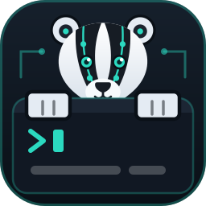
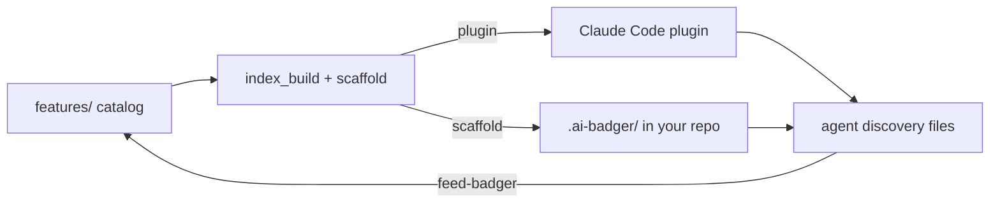

<p align="center">
  
</p>

# ai-badger

[](https://github.com/Arasz/ai-badger/actions/workflows/pylint.yml)
[](docs/changelog/README.md)
[](LICENSE)

ai-badger gives Claude Code, GitHub Copilot, Hermes, pi and Codex the same instructions, skills,
personas and hooks in one repository, written into each agent's native files. The source is one
catalog filed under `features/{stack|common}/{feature}`. Claude Code installs it as a plugin; the
other four get it through a per-repo scaffold. `welcome-ai-badger` sets a repo up, and
`feed-badger` sends what you improve there back to the catalog.



The detailed version is [Data flow, end to end](docs/framework-architecture.md#7-data-flow-end-to-end).

## Supported agents

| Agent | Install route | Discovery file | Known gap |
|---|---|---|---|
| Claude Code | plugin + scaffold | `CLAUDE.md`, `.mcp.json` | none |
| GitHub Copilot | scaffold | `.github/copilot-instructions.md`, `.github/mcp.json` | no plugin install; `feed-badger` has no programmatic route |
| Hermes Agent | scaffold | `HERMES.md` | no per-project MCP config, so the MCP block is printed for you to merge into `~/.hermes/config.yaml` |
| pi | scaffold | `AGENTS.override.md`, `.pi/agents/` | no plugin install; `feed-badger` has no programmatic route |
| Codex | scaffold | `AGENTS.md`, `.codex/agents/*.toml` | partial hook parity; see [Codex support](docs/codex.md) |

`features/common/support.json` is the matrix of record, one entry per agent per capability.
Each directory under `features/` is a stack (languages such as python or ts, platforms such as
github, and the agents themselves); detection picks the ones your repo uses.

## Quick Start

In Claude Code, install the plugin:

```
/plugin marketplace add https://github.com/Arasz/ai-badger
/plugin install ai-badger@ai-badger
```

Then run `welcome-ai-badger` inside the repo you want to set up. It detects stacks, agents and
commands, asks you to confirm a `.ai-badger/config.json` profile, and writes `.ai-badger/` plus
each agent's discovery file: for Claude Code that is `CLAUDE.md`, `.claude/agents/` and
`.mcp.json`. You review the result and commit it.

- `den-refresh` pulls framework updates into a scaffolded repo with its existing config.
- `feed-badger` sends project-agnostic improvements back to this repo as a draft PR.

Copilot, Hermes and pi users clone the framework instead: see
[Route B](docs/getting-started.md#route-b--clone-the-framework-and-point-ai_badger-at-it).
Codex setup is in [`docs/codex.md`](docs/codex.md). pi extensions live in
[pi-badger-integration](https://github.com/Arasz/pi-badger-integration). Install modes and
external plugins are in [Install modes](docs/skills.md#install-modes).

## What it does

| Area | What you get | Docs |
|---|---|---|
| Catalog and scaffolder | One stack × feature tree rendered into each agent's native files | [framework-architecture.md](docs/framework-architecture.md) |
| Skills | Installable workflows the agent matches by description or you call by name | [skills.md](docs/skills.md) |
| Hooks | Behaviour that fires unasked: memory context, the dispatch gate, the generated-file guard, the drift notice | [Hooks](docs/framework-architecture.md#hooks) |
| Gates | CI and pre-push checks that exit non-zero instead of warning | [scripts.md](docs/scripts.md) |
| Task pipeline | `/task` runs one backlog item end to end; `task-graph` holds its step DAG | [task](docs/skills.md#task) |
| MCP servers | Bundled servers, `task-graph` among them, written into the agent's MCP config | [Bundled MCP servers](docs/framework-architecture.md#bundled-mcp-servers) |
| Tool recommendations | Each prompt is matched against an index of your MCP tools, and the best few are suggested to the agent | [retrieval.md](docs/retrieval.md) |

## Measured, not claimed

Two figures from this repo's own history, each with the conditions it was measured under:

- Across 1250 real Claude sessions, cache efficiency (the share of input tokens served from the
  prompt cache) sat at 0.975-0.986 on every one, so it cannot tell a cheap task from a costly
  one. That is why `/task` records which models did the work instead
  ([0.56.0](docs/changelog/0.56.0-a-task-records-which-model-did-the-work.md)).
- Of 205 measured subagent launches, 101 named no model and silently ran on the session's
  model. A `PreToolUse` gate now denies those
  ([0.60.0](docs/changelog/0.60.0-delegation-becomes-a-mechanism.md),
  [ADR-0015](docs/adr/0015-delegation-needs-a-mechanism-not-more-prose.md)).

## What's new

- [0.201.0](docs/changelog/0.201.0-discover-reads-claude-code-init.md): `mcp-index --discover`
  reads tool names from Claude Code's init event.
- [0.200.2](docs/changelog/0.200.2-semantica-catalog-current-tools.md): the semantica catalog
  covers the tools semantica 0.6.8 serves.
- [0.200.1](docs/changelog/0.200.1-synced-plugins-and-catalog-refresh.md): `--discover` finds
  plugins synced from claude.ai.

Full history: [docs/changelog/README.md](docs/changelog/README.md). `BREAKING_VERSIONS` lists
the versions that need a full re-scaffold, and `den-refresh` handles them; see
[`RELEASING.md`](RELEASING.md).

## Requirements

- Python 3.10+ and `python3 -m pip install -r engine/requirements.txt`.
- `uv`, which launches the `task-graph` server and CLI as PEP 723 scripts.
- Node 18+ for the `.mjs` scripts.
- To contribute: `bun` as well, for the pi TypeScript lane the pre-push hook runs.

What each dependency is for: [Step 0](docs/getting-started.md#step-0--dependencies).

## Project layout

```
features/   the catalog: features/<stack>/<feature>/<item>
skills/     the plugin's skill directories
hooks/      the plugin's hook wiring
schemas/    JSON schemas for config, manifest and scaffolding files
engine/     shared library and runtime requirements
tooling/    index_build, validate, version sync and other scripts
gates/      repo gates run in CI and pre-push
tests/      the pytest and JS suites
docs/       user and maintainer documentation
```

The full tree is in [Repository layout](docs/framework-architecture.md#repository-layout).

## Documentation

Start at [`docs/README.md`](docs/README.md), the documentation map. The main pages are
[getting-started](docs/getting-started.md), [skills](docs/skills.md),
[scripts](docs/scripts.md), [dictionary](docs/dictionary.md),
[retrieval](docs/retrieval.md) and the [ADR index](docs/adr/README.md). Screenshots used by the
docs are in [`docs/screenshots/`](docs/screenshots/README.md).

## Contributing & Security

- [`CONTRIBUTING.md`](CONTRIBUTING.md): branch, failing test first, one task per PR. A
  docs-only change needs no `VERSION` bump.
- [`RELEASING.md`](RELEASING.md): how a release is cut and tagged.
- [`SECURITY.md`](SECURITY.md): report privately through GitHub's Security tab, never a
  public issue.
- [`CODE_OF_CONDUCT.md`](CODE_OF_CONDUCT.md) governs participation.

The logo and its usage rules are in [`docs/brand/README.md`](docs/brand/README.md).

## License

MIT, per [`LICENSE`](LICENSE). Copyright (c) 2026 Rafał Araszkiewicz.
