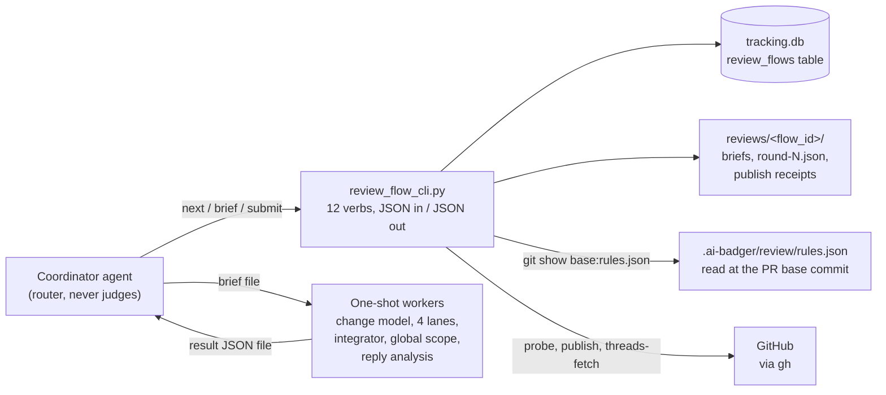
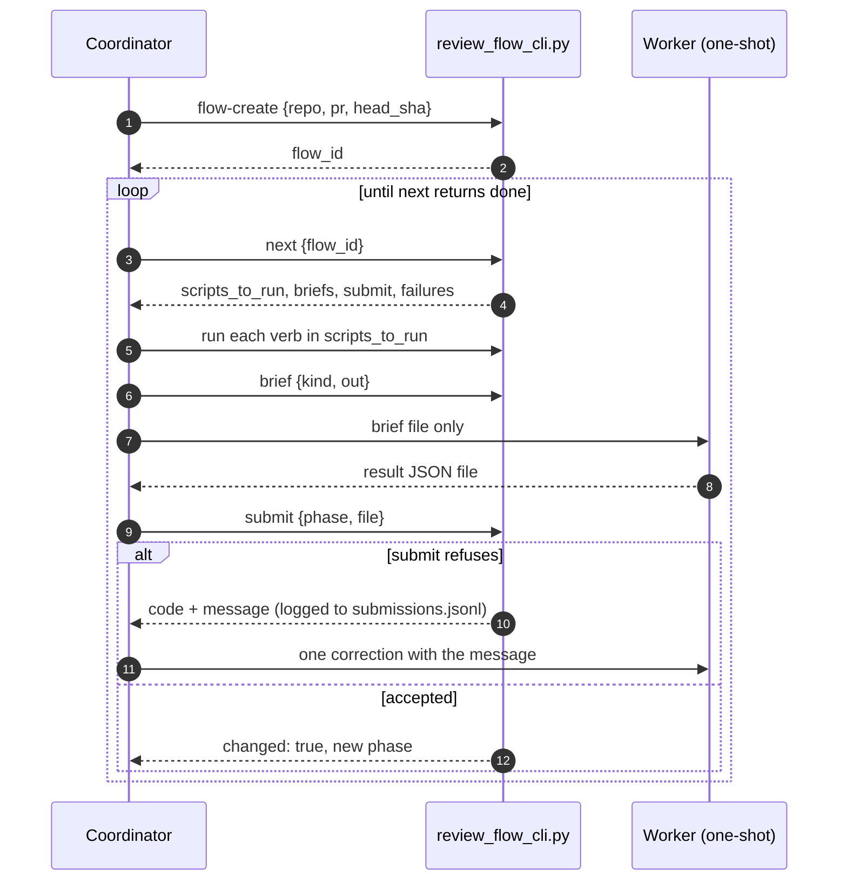
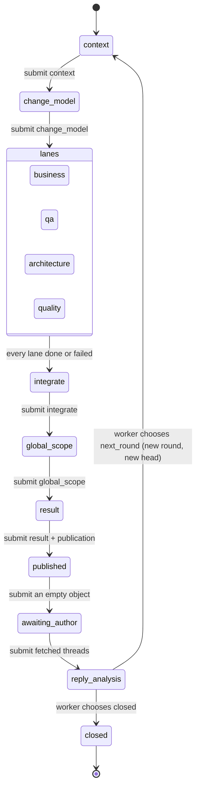
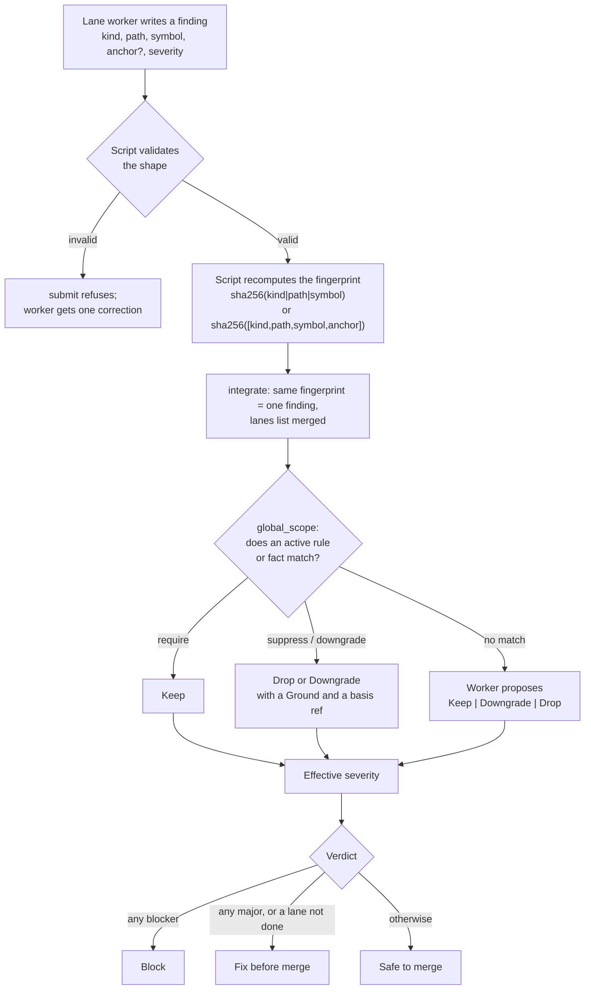
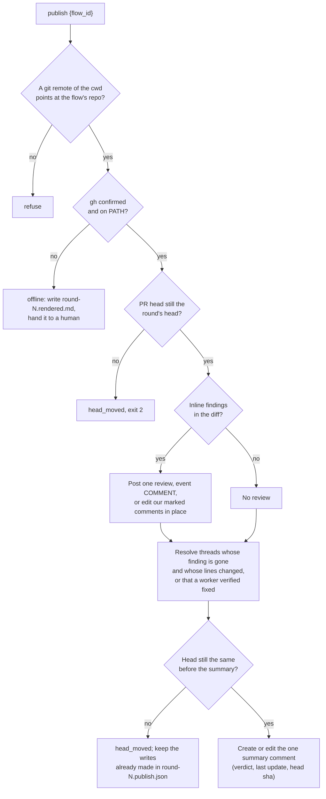
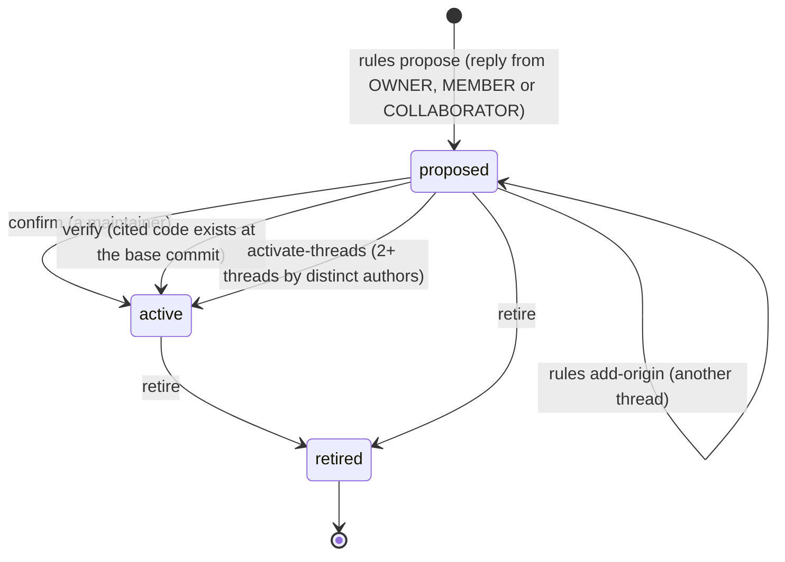

# The review-flow skill

`review-flow` reviews a GitHub pull request from start to end. One coordinator agent moves a
typed review flow through fixed phases. Scripts do each step that has a checkable answer.
One-shot workers do each step that needs judgement. The flow posts compact comments on the PR,
reads the author's replies, and turns good replies into review rules that the next round
applies.

The skill is [`features/common/skills/review-flow/SKILL.md`](../../features/common/skills/review-flow/SKILL.md).
The decision record is [ADR-0051](../adr/0051-review-flow-coordinator.md). This page explains
how the parts fit together. For the exact verb arguments, read the skill.

## When to use it, and when not to

Use it when a PR needs a full review (context, lanes, verdict, comments), when the author
replied to an earlier round and the review must continue on the new head, or when replies
must teach rules for later rounds.

Use a different skill for narrower jobs:

| Job | Skill |
|---|---|
| Rank one diff by blast radius | `review-changes` |
| Pass/fail gates for style, security, layering | `code-review-checklist` |
| Judge a test suite only | `review-tests` |
| Review the whole project, not a diff | `complete-project-scope-code-review` |

## The parts

The coordinator only routes. It asks the CLI what to do next, builds briefs, dispatches
workers and hands their files back to the CLI. It never edits a finding, never writes a
comment body and never moves a phase by hand. The CLI is the only writer of flow state.

Each verb reads one JSON object and prints one JSON object. Exit codes are `0` success, `1`
tool error, `2` usage error or refused publish, `3` launch failure (no `pydantic`). The CLI is
a PEP 723 script. It starts with `uv run --script`; without `uv` it falls back to `python3`
when `pydantic` imports.

| Verb | Job |
|---|---|
| `flow-create` | Open a flow for `owner/name`, PR number and head sha |
| `next` | Say which scripts to run, which briefs to build, which phase to submit |
| `brief` | Write one worker brief for a brief kind |
| `submit` | Validate a worker file and move the phase; the only verb that moves state |
| `tools-probe`, `tools-confirm` | List available tools, then pin the ones this flow may use |
| `context-probe` | Read the PR, linked issues and acceptance criteria |
| `facts-add` | Add a graded project fact to the rules file |
| `rules` | Propose, add an origin to, confirm, verify, activate, retire or list rules |
| `result-build` | Freeze the verdict in `round-N.json` and `round-N.md` |
| `publish` | Post or edit the review and the summary comment |
| `threads-fetch` | Read the replies on threads that start at our own findings |

## The coordinator loop

Two details keep the loop safe to repeat. A second submit of the same file returns
`"changed": false` and leaves the flow alone. Each refusal goes to `submissions.jsonl`, and
`next` shows the last ten refusals of the round, so a coordinator that lost its context can
still see what went wrong.

## The phase machine

Every round moves through the same phases. The transition table in
`review_flow_model.py` allows exactly one next phase for each phase, and `submit` refuses any
other move. Each move is recorded in `ReviewFlow.history` with its round number.

| Phase | What happens | Who does it |
|---|---|---|
| `context` | Confirm tools, read the PR, issues and acceptance criteria. Pin the base commit. | Scripts; the coordinator reads Jira only through a confirmed tool |
| `change_model` | Describe what the change does, unit by unit, with risks | One `architect` worker; the script checks the shape |
| `lanes` | Four parallel reviews: `business`, `qa`, `architecture`, `quality` | Four workers; the script validates findings and recomputes fingerprints |
| `integrate` | Merge true duplicates across lanes | Script dedups by fingerprint; a worker judges near-duplicates |
| `global_scope` | Apply rules and facts, then dispose of the rest | Script applies `require`/`suppress`/`downgrade`; a worker proposes each `Disposition` |
| `result` | Freeze the verdict and publish | Scripts only |
| `published` | Wait until the review shows on GitHub | Coordinator |
| `awaiting_author` | Wait for replies, then fetch them | `threads-fetch` |
| `reply_analysis` | Read replies, propose rules, choose `closed` or `next_round` | One worker; the script validates each rule |

A failed lane does not stop the round. It does stop the round from reaching "Safe to merge".

## How a finding becomes a verdict

Severity is one closed, ordered enum: `blocker | major | minor | nit`. The ADR maps the five
older vocabularies of the other review skills onto it.

The fingerprint leaves out the line number and the title on purpose. A finding that moves to a
new line, or gets a new title, is still the same finding. The optional `anchor` is the
offending code text, with whitespace normalised and cut to 200 characters. It keeps two defects
in one function apart. A worker cannot set the fingerprint; the script always computes it again.

A `Downgrade` or `Drop` must name a `Ground` (`fact_contradicts`, `unreachable_in_production`,
`rule`, `duplicate`, `out_of_scope`) and at least one fact or rule as its basis. The ground
`unreachable_in_production` needs the `DEFENSIVE` tag on the finding, and it can only
downgrade, never drop.

The verdict is derived, never stored on the model. `result-build` freezes it once in
`round-N.json`; a second call returns the frozen file unchanged.

## Publishing

**Warning:** a real publish posts comments that other people see at once. Always run
`publish` with `"dry_run": true` first and read the planned `ops`. Add `"offline": true` to
render the bodies into `round-N.rendered.md` with no GitHub call at all.

The review event is always `COMMENT`. The flow never approves and never requests changes.

Each inline comment has a human part of at most four lines (reason and severity), then a
collapsed `
` block for the agent (reproduction path, wider context, proposed fix).
The renderer refuses a longer human part; it never truncates it. Findings outside the diff go
into the summary instead of inline.

Three hidden markers identify the flow's own objects: `finding`, `summary` and `resolved`. A
marker counts only on a comment written by the login that `gh api user` returns, so another
user cannot plant a fake marker and make the flow edit their comment.

A thread is resolved only when its finding is gone and its anchored lines changed, or when the
`reply_analysis` worker listed it as verified fixed. Otherwise the summary marks it "not
re-reported".

## Learned rules and project facts

Rules and facts live in `.ai-badger/review/rules.json`, a committed file. The flow always reads
it at the PR base commit, never at the PR head, so a PR cannot change the rules that review it.
A PR that edits the file gets a `config` finding instead. `Round.rules_digest` pins the sha of
the file the round used.

A rule or fact matches with `Applies{kinds, paths, symbols}` (a conjunction of fnmatch globs)
and acts with `Effect{action: require | suppress | downgrade}`. That is the whole grammar: no
expressions. Two active rules conflict when their kinds and path globs overlap and one requires
while the other suppresses or downgrades. Both are then left out of the lanes.

A proposed rule does nothing until it is active. Ids (`R-n`, `F-n`) only go up and are never
reused; a rule is retired, never deleted. Each rule action writes the rules file in the working
tree. Commit it in its own PR so a maintainer reviews it, and it applies to reviews only after
it merges to the base branch.

A fact is a graded statement about the whole system, for example "the gateway retries two
times", with an evidence reference. Add one with `facts-add`. The global-scope worker uses
facts to drop or downgrade findings that the wider system already handles.

## Where state lives

| What | Where |
|---|---|
| Flow state (rounds, phases, findings, history) | `review_flows` table in `tracking.db`, compare-and-swap on a revision |
| Briefs, worker files, refusals, frozen results, publish receipts | `<tracking root>/reviews/<flow_id>/` |
| Confirmed tools | `tools.json` in the flow directory |
| Rules and facts | `.ai-badger/review/rules.json`, read at the pinned base commit |

Set `AI_BADGER_TRACKING_ROOT` to move the tracking root. The table is added with
`CREATE TABLE IF NOT EXISTS` and no schema version bump, so an older ai-badger copy still opens
the database.

## Trust boundaries

- Untrusted text (PR body, issue, reply, rule statement) enters a brief only inside one fenced
  data block, capped at 4000 characters a field. A worker treats it as data.
- The `context` submission must carry the PR base commit. With `gh`, submit accepts only the
  PR's real `baseRefOid`; without `gh`, only a full 40-hex sha. Every later read of rules,
  facts and project commands uses that pinned commit, not the checkout.
- Publish always names the repo explicitly and refuses when the head moved since the round
  started.
- All child processes (`gh`, `git`) are read as UTF-8, and the CLI writes its JSON as UTF-8, so
  the flow works on a Windows code page without `PYTHONUTF8=1` (since 0.221.1).

## Limited environments

The flow runs with no hooks and no MCP server; v1 is CLI only. Without `uv` it falls back to
`python3` with `pydantic`. Without `gh`, publish runs offline and `threads-fetch` refuses with
`offline`. Each tool in the Tools table of the skill has a named fallback, for example `git
diff` plus `grep` graded `INFERRED` when `code-review-graph` is absent. Projects with the
`limited-env` stack get the extension at
`features/common/skills/review-flow/extensions/limited-env/extension.md`.

## Not in v1

No Jira adapter code (Jira only through a confirmed MCP tool), no committable suggestion
blocks, no auto-polling for replies, no publishing outside GitHub, no rule sharing across
projects, and no MCP server. An MCP twin can wrap the same verbs later without a model change.
