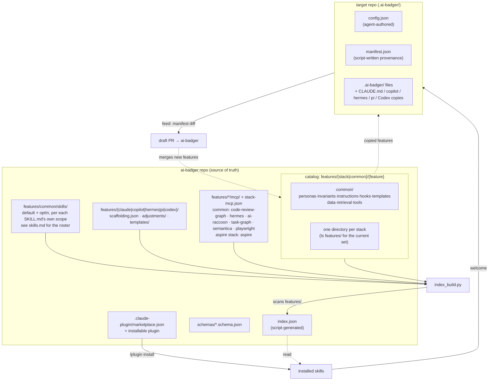
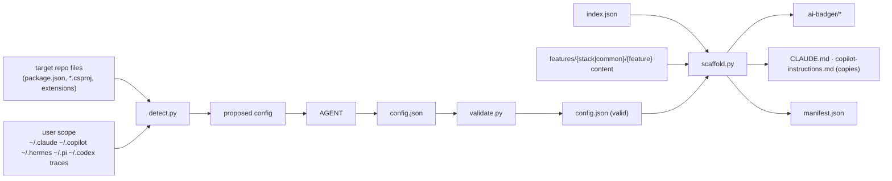
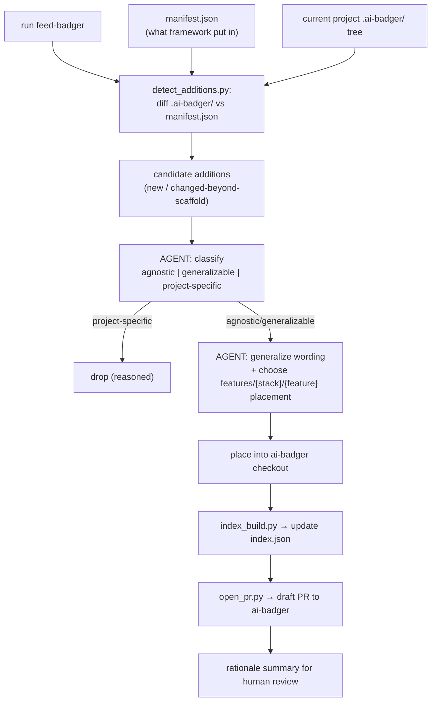

# ai-badger framework architecture

This document explains how ai-badger is put together: the stack×feature catalog model, the two
JSON contracts that connect the framework to a target project, the hard split between what
scripts do and what the agent does, how skills/hooks/adjustments and the `task` skill compose, and the structure
`welcome-ai-badger` produces inside a target repo. It assumes you've read the top-level
[`README.md`](../README.md) quickstart first.

## 1. The stack×feature catalog model

The framework repo is organized as **stack × feature**, rooted under `features/`:

- **stack** — a technology: `dotnet`, `azure`, `cosmos`, `terraform`, `mcp`, `node`, `js`, `ts`,
  `react`, `css`, `github`, `angular`, … plus **`common`** for stack-agnostic content.
- **feature** — a kind of framework asset: `personas`, `invariants`, `instructions`, `skills`, `hooks`, `adjustments`,
  `mcp`, `data`, `retrieval`, and — `common`-only — `templates`. Stack-scoped skill *extensions* also live here,
  nested under a stack's `skills/` directory (§5).

```
features/<stack>/<feature>/<item>
```

Each feature item is a small, self-describing unit:

| feature | shape | discovery rule |
|---|---|---|
| `personas` | `*.md` file | named by filename stem |
| `invariants` | `*.md` file | named by filename stem |
| `instructions` | `*.md` file | named by filename stem |
| `skills` (external) | `skills-source.json` + `skills.json` | at most one pair per stack |
| `hooks` | `hooks-manifest.json` + hook files | at most one manifest per stack |
| `adjustments` | `adjustment.json` + scripts | per-agent, at most one descriptor |
| `mcp` | directory | any subdir of `features/<stack>/mcp/` containing a `meta.json`; one MCP server each |
| `tools` | directory | any subdir of `features/<stack>/tools/` containing a `meta.json` (`schemas/tool.schema.json`); one external CLI each, wired only when `config.tools` names it; a spec's `guard` script is inlined into the hook command in place of `<tool> hook` (ADR-0039) |
| `data` (`common` only) | file/dir | every top-level entry. `model-groups.json` maps a persona's `model:` lane to a real model id |
| `retrieval` (`common` only) | `*.py` | the BM25 matcher, tokenizer and eval fixtures behind the MCP tool index (ADR-0012) |
| `templates` (`common` only) | file/dir | every top-level entry |
| `skills` (extensions only, e.g. `github`) | directory | `<base>-extensions/<ext>/` containing a manifest, attached by directory convention (§5) |

Some files sit beside the feature directories rather than inside one, because they describe
the stack instead of belonging to it. For example: `features/<stack>/stack-mcp.json` (which MCP
servers this stack wants and how to launch them), `features/common/mcp-tags.json` (the closed tag
vocabulary an MCP tool must draw from), `features/common/support.json` (the agent capability
matrix) and `features/common/dependencies.json` (what a feature needs installed before it
works). Stacks also carry `stack.json`, `skills-source.json` and `plugins-instructions.json`
where they need them, and every agent stack has a `scaffolding.json` (below).

How each kind behaves once scaffolded:

- **personas**, **invariants** and **instructions** are individual `*.md` files, named by
  filename stem.
- **skills** live at `features/common/skills/`, each a `SKILL.md` plus scripts and references.
  A skill declares its own routing in frontmatter (`stacks:` and `scope:`). Config-gated
  extensions live inline at `features/common/skills/<skill>/extensions/<ext>/` with
  `extension.json` activation conditions. A skill may carry a seed-once `project-local.md` for
  project-specific additions. A skill with a `<!-- MERGE_EXTENSIONS -->` marker in `SKILL.md`
  has its extensions merged into the skill file at scaffold time; the others keep them as
  separate files.
- **hooks** live at `features/common/hooks/` with a `hooks-manifest.json` naming each hook's
  wiring per agent. Claude, Copilot and Hermes wire from that manifest. pi registers no per-hook
  arm, so a new tool-event hook arms pi with no manifest edit and no adapter change (ADR-0022).
  The hooks themselves are listed under [Hooks](#hooks).
- **adjustments** are per-agent scaffold adjustments at `features/{agent}/adjustments/`, each
  driven by an `adjustment.json` that names its scripts.
- **mcp** holds one directory per server at `features/<stack>/mcp/{server}/`, each with a
  `meta.json` declaring its prerequisite. What a server is for travels with the catalog whatever
  route the server arrived by; `features/{stack}/stack-mcp.json` separately declares the ones
  ai-badger may launch ([ADR-0014](adr/0014-mcp-support-is-configuration-not-retrieval.md)).
  See [Bundled MCP servers](#bundled-mcp-servers).
- **tools** holds one directory per external CLI at `features/<stack>/tools/{tool}/`: a
  `meta.json` ([`schemas/tool.schema.json`](../schemas/tool.schema.json)), a `tool.md` rendered
  into every agent file, and `check` and `install` scripts. Nothing is wired until the project
  names the tool in `config.tools`; each agent's `adjust_tools` then adds the tool's marked hook,
  or prints a proposal where the tool declares one. The catalog ships no tool of its own
  ([ADR-0039](adr/0039-tools-feature-type.md)).
- **data** and **retrieval**: `features/common/data/model-groups.json` maps a persona's `model:`
  lane to a real model id, and `features/common/retrieval/` holds the BM25 matcher, tokenizer and
  eval fixtures behind the MCP tool index (ADR-0012). Both are catalog content the scaffolder
  copies; neither is prose. [`retrieval.md`](retrieval.md) covers how the index is searched.

### `scaffolding.json`: declarative agent file generation

Each agent has a `features/<agent>/scaffolding.json` that declares which files to scaffold into
a target project, so `scaffold.py` carries no hardcoded agent-specific logic. The contract is
[`schemas/scaffolding.schema.json`](../schemas/scaffolding.schema.json). pi's stack is the one
with compiled surface: its `adjustments/adapter/` is TypeScript with its own `package.json` and
tests, because pi loads extensions as `.ts` modules that shell out to the Python hooks.

This keeps every asset generalizable at the point of authorship: a persona, invariant, or
instruction that is genuinely stack-agnostic goes in `common`; anything that only makes sense
given a specific technology (a routing table entry, a module invariant like *Domain purity* or
*single-writer-Cosmos*) is filed under its owning stack instead of being force-generalized or
duplicated.

A project can also add invariants of its own: every `*.md` under the scaffolded
`.ai-badger/invariants/local/` is read fresh on each scaffold and rendered after the catalog
invariants, demoted like them. The directory is project-owned — files are never copied,
recorded in the manifest, pruned, or overwritten (issue #313).

### Skills location

Skills live under `features/common/skills/`. Each one declares its own `scope` in its
`SKILL.md` frontmatter (ADR-0018): `default` ships without being asked for, `optIn` ships only
when a project names it in `config.include.skills`. Nothing here counts them or names them —
that list is [`skills.md`](skills.md)'s job, and it derives its numbers from the same
frontmatter rather than keeping a second copy in sync. All of them are discovered by
`iter_feature_dirs` like any other stack feature.
(`auto-wm` lives at `features/claude/skills/` since it depends on Claude Code's `PreToolUse` hooks.)
Stack-scoped skill *extensions* live inline inside the base skill directory (e.g.
`features/common/skills/task/extensions/github/`). `scaffold.py` embeds them when their
`extension.json` `requires` conditions are met and prunes them otherwise.

The repo-root `skills/` directory is the generated plugin copy of the catalog skills that Claude
Code's plugin loader reads. Never edit it: `tooling/sync_plugin_skills.py` rewrites it from
`features/` ([ADR-0008](adr/0008-plugin-skills-live-at-the-plugin-skill-path.md)). The scaffolder
symlinks `.hermes/skills/` for Hermes auto-discovery. Codex receives project
`.agents/skills/<name>` symlinks to the same embedded skill directories; OpenAI documents symlink
discovery explicitly. See [`codex.md`](codex.md).

### `index.json` — the source of truth

`index.json` at the repo root is **script-generated** by `tooling/index_build.py`, which scans
the tree above and never accepts hand edits. It is regenerated after *any* framework content
change and is the one thing `welcome-ai-badger` and `feed-badger` read to know what exists and
where:

```jsonc
{
  "frameworkVersion": "0.1.0",
  "stacks": {
    "common": {
      "skills":       [ { "name": "task", "path": "features/common/skills/task", "scope": "default" } ],
      "personas":     [ { "name": "architect", "path": "features/common/personas/architect.md" } ],
      "invariants":   [ /* … */ ],
      "instructions": [ /* … */ ],
      "hooks":        [ { "name": "hooks-manifest", "path": "features/common/hooks/hooks-manifest.json" } ]
    },
    "dotnet": { "personas": [ /* … */ ], "invariants": [ /* … */ ], "instructions": [ /* … */ ] },
    "react":  { /* … */ }
  }
}
```

Note that `skills` entries are keyed under `stacks.common` (the `task` skill's declared stack)
and their `path` points at `features/common/skills/`.

Because it's derived, `index.json` can never drift from the tree by construction — as long as
you remember to regenerate it (see [`authoring-a-feature.md`](authoring-a-feature.md)).
`tooling/validate.py --all` checks it against `schemas/index.schema.json` along with every other
model in the repo.

### Hooks

A skill waits to be invoked. A hook does not. The catalog wires hooks into
`.claude/settings.json`, `.github/hooks/` and the Hermes plugin at scaffold time. The two
tool-event families run on pi as well, through a TypeScript adapter that reads the same generated
`hooks.json` at event time, so a new gate lands on pi with no adapter edit
([ADR-0022](adr/0022-pi-arms-hooks-dynamically.md)).

| Hook | What it does when you did not ask |
|---|---|
| `memory-context` | Searches project memory for each user prompt and injects the matched excerpts ([ADR-0031](adr/0031-per-prompt-memory-context-through-the-ai-raccoon-proxy.md)) |
| `context-enrichment` | Recommends MCP tools per turn out of the BM25 index ([ADR-0012](adr/0012-bm25-retrieval-with-a-falsifiable-eval.md)) |
| `message-delivery` | Puts another session's mail in front of you at session start, every turn, and again at turn end |
| `dispatch-gate` | Denies a subagent dispatch that names no model and whose persona has no lane |
| `generated-file-guard` | Refuses a hand edit to a file the scaffold generated, and names the `features/` source to edit instead |
| `memory-first-gate` | Blocks repo text search until the session has consulted memory ([ADR-0017](adr/0017-memory-first-gate.md)) |
| `git-internals-guard`, `blast-radius-kill-guard` | Refuse the edit or the bare `kill` that damages a repo other lanes are working in |
| `commit-reminder`, `test-run-economy` | Count what you are doing and say something when it crosses the line |
| `grounded-feedback` | Carries a failed command's real output into your next correction turn |
| `drift-notice` | Tells the session its `.ai-badger/` is behind the framework ([ADR-0001](adr/0001-versioning-and-release-model.md)) |

The table is what Claude Code arms. Copilot and Hermes arm most of it, including the bus rows. On
pi the `PreToolUse` and `PostToolUse` rows run through the adapter, while the session- and
turn-level ones are the adapter's own bus router.
`features/common/hooks/hooks-manifest.json` is the full list, one entry per hook per agent, and
[`skills.md`](skills.md) marks which skills are hook-backed rather than named.

The `dispatch-gate` row exists because of what the tracker measures. The `/task` skill reads the
session transcript, including `<session-id>/subagents/*.jsonl` where dispatched work lives, and
records which model produced each task's output, how many dispatches ran, and how many declared a
model. `task_tracker.py status` prints the mix, for example `mix=opus-5:69%`. Model mix is tracked
rather than cache efficiency because cache efficiency saturates: it measured 0.975 to 0.986 across
1250 sessions, so it cannot separate a cheap task from a costly one, while model mix can. Since
0.60.0 the leak is also closed up front: every persona carries a `model:` lane and a `level:`
beside it ([ADR-0027](adr/0027-dual-key-persona-levels.md)), and a `PreToolUse` gate on `Agent`
denies a dispatch that names neither a model of its own nor a persona that has one
([ADR-0015](adr/0015-delegation-needs-a-mechanism-not-more-prose.md)).

### Bundled MCP servers

Each server is a catalog item under `features/<stack>/mcp/<server>/`, carrying the prose injected
into every agent file, its prerequisite and its install command. `welcome-ai-badger` and
`den-refresh` scaffold them into the project.

| Server | What it does |
|---|---|
| [**code-review-graph**](https://github.com/tirth8205/code-review-graph) | Local-first code intelligence graph for MCP. Builds a persistent map of your codebase so AI coding tools read only what matters, used for code review, impact analysis, and architecture exploration. |
| [**ai-raccoon**](https://github.com/Arasz/ai-raccoon) | Memory server: semantic search, durable-fact writes, workspaces, docs watching. Declared only when `ai-raccoon` is on PATH, and user-scoped: the operator registers it once, in a user-global config, so no project file carries it ([ADR-0044](adr/0044-project-scope-decision-for-an-mcp-server.md)). |
| [**semantica**](https://github.com/semantica-agi/semantica) | Graph-native knowledge infrastructure: entity extraction, decisions with W3C PROV-O provenance, causal chains. Declared only when `semantica-mcp` is on PATH. |
| [**playwright**](https://playwright.dev/docs/getting-started-mcp) | Browser automation over MCP: accessibility snapshots, element refs, network inspection. Declared only when `npx` is available, since it launches through `npx -y`. |
| [**hermes**](https://hermes-agent.nousresearch.com/docs/user-guide/features/mcp#running-hermes-as-an-mcp-server) | Hermes Agent's stdio MCP bridge: list conversations, read history, poll live events, send messages, manage approvals. Declared only when `hermes` is on PATH. |
| **task-graph** | The decomposed task plan as a DAG of steps with status, acceptance criteria and evidence, persisted in the project's `tracking.db`. Launched through `uv`. |

`features/common/mcp/` holds ai-raccoon, code-review-graph, hermes, playwright, semantica and
task-graph. `aspire` is catalogued in `features/aspire/mcp/` and is the Aspire CLI's own
`aspire agent mcp` surface, so it is described but never launched by ai-badger.
`features/common/stack-mcp.json` says which servers the `common` stack wants and which of them are
written into `.mcp.json` during scaffold
([ADR-0014](adr/0014-mcp-support-is-configuration-not-retrieval.md)). Availability is per server:
`hermes`, `ai-raccoon`, `semantica` and `playwright` each depend on their own launcher being
present, while `code-review-graph` and `task-graph` carry no availability condition. A server
can also carry a `scope`: `project` (the default) means ai-badger writes its launch config into
the project files it owns, `user` means the operator registers it in a user-global config and
ai-badger writes it nowhere. A project overrides that decision for a named server with
`config.mcp.scope` ([ADR-0044](adr/0044-project-scope-decision-for-an-mcp-server.md)).

> **Hermes users:** Hermes reads MCP servers only from `~/.hermes/config.yaml`
> (`mcp_servers:`). It has no project route, so a server written to `.mcp.json` is
> invisible to Hermes sessions. ai-badger prints the block to merge instead of writing
> user-global config (ADR-0014 decision 6); run `hermes mcp add <name> --command <cmd>`
> once per machine (or merge the printed block) to make a server available to Hermes.

### Repository layout

```
ai-badger/
  index.json                     # SOURCE OF TRUTH: every feature for every stack (script-generated)
  README.md   LICENSE (MIT)   VERSION   BREAKING_VERSIONS
  CONTRIBUTING.md   SECURITY.md   CODE_OF_CONDUCT.md   RELEASING.md
  AGENTS.md                      # Codex discovery copy of this repo's own instructions
  lefthook.yml                   # local git-hook runner for the gates
  pyproject.toml                 # tool configuration (pylint, pytest)
  .claude-plugin/marketplace.json   # ai-badger is itself installable, plugin source "./"
  .claude-plugin/plugin.json        # the installable plugin wrapping the root skills
  skills/                        # What the plugin exposes to Claude Code (generated from features/)
  hooks/hooks.json               # The plugin's own runtime wiring (the drift-notice hook)
  schemas/                       # JSON Schema for every *.json model
  engine/                        # The library every bootstrap shim imports: badger_lib, badger_store
  tooling/                       # Maintainer catalog and release tooling (no LLM, no network)
  gates/                         # Repo quality gates, run only by CI and the pre-push hook
  tests/                         # The suite the gates are themselves verified against
  docs/                          # Architecture, authoring guides, ADRs
  features/
    common/
      skills/                    # default + optIn, per each SKILL.md's own scope (see skills.md)
      personas/{architect, test-engineer, code-reviewer, qa, delegator}.md
      invariants/*.md            # Agnostic invariant snippets
      instructions/*.md          # Agnostic scoped instructions
      hooks/                     # Hook scripts + hooks-manifest.json (claude, copilot, hermes)
      retrieval/*.py             # BM25 matcher, tokenizer, eval fixtures for the MCP tool index
      data/model-groups.json     # A persona's model: lane mapped to a real model id
      skills-source.json         # External skill sources
      skills.json                # External skills to install
      mcp/                       # MCP server catalog (code-review-graph, ai-raccoon, semantica, ...)
      tools/                     # External CLI catalog, one meta.json each
      mcp-tags.json              # The closed tag vocabulary an MCP tool must draw from
      stack-mcp.json             # Which MCP servers this stack wants, and how to launch them
      support.json               # Agent capability matrix
      dependencies.json          # What a feature needs installed before it works
      templates/                 # CLAUDE.md.tmpl, HERMES.md.tmpl, delegation.md.tmpl,
                                 # state.json, agent-instructions
    dotnet/ azure/ aspire/ cosmos/ terraform/ mcp/ changelog/ python/  {personas,invariants,instructions}/...
    github/ react/ vue/ angular/ node/ js/ ts/ css/ ux/  {personas,invariants,instructions}/...
    ai-raccoon/                  # The memory server's own stack: its skill and its CLI dependency
    claude/ copilot/ hermes/ pi/ codex/ # Agent stacks: scaffolding.json, adjustments/, templates/
                                 # pi additionally ships the TypeScript hook adapter and its tests
```
Derive the stack list rather than trusting this tree: `ls features/`.

## 2. The two contracts

Two JSON files connect the framework to a target project. Both are schema-validated
(`schemas/config.schema.json`, `schemas/manifest.schema.json`) with a required subset, the same
way every `*.json` model in ai-badger is.

### `config.json` — project profile (agent authors, script validates)

Lives at `.ai-badger/config.json` in the target repo. It's the single input the scaffolded
skills read at runtime — everything downstream (which invariants apply, which `task` extensions
activate, what commands to run) is derived from it.

```jsonc
{
  "$schema": "…/config.schema.json",
  "frameworkVersion": "0.1.0",
  "project": { "name": "…", "summary": "…", "domain": "…" },
  "stacks": ["ts", "react", "node", "css"],
  "agents": ["claude", "copilot"],
  "sourceControl": { "platform": "github", "repoUrl": "https://github.com/Arasz/arasz-home-page", "projectUrl": null },
  "commands": { "build": "bun run build", "test": "bun run test", "lint": "bun run lint", "run": "bun run dev" },
  "personaRouting": [ { "work": "frontend UI/UX", "agent": "frontend-engineer" } ],
  "skillScope": "default",
  "docs": { "architecture": "docs/…" }
}
```

The example shows the common keys. [`schemas/config.schema.json`](../schemas/config.schema.json)
is the full list. Three of the rest control what leaves the machine or what the agent may call:

- `dataPolicy` locks the project to loopback-only model calls. The string `"local-only"` or the
  mere presence of the key locks; the object form relaxes it for named https hosts, and only for a
  session that opted in.
- `tools` names the catalog tools (`features/<stack>/tools/<tool>/`) the project opts into. Nothing
  is wired unless it is named here.
- `mcp` decides which of the catalog's MCP servers the agent may call and whether ai-badger
  pre-approves them (ADR-0014).

Its role is to **gate extensions**: a `task` extension or a plugin entry activates *iff* the
data it needs is present in `config.json`. For example, the `task` GitHub extension (issue/PR
creation, Copilot review loop) only turns on when `sourceControl.platform == "github"` and
`sourceControl.repoUrl` is set; project-board features additionally need
`sourceControl.projectUrl`.

`detect.py` produces a *proposed* `config.json` mechanically (stacks from package/project files,
agents from `CLAUDE.md`/`.github/copilot-instructions.md` traces in repo and user
scope, commands from common scripts). The agent then refines it — filling in project summary,
domain, and persona routing, asking clarifying questions only for genuine ambiguity — before
handing it to `validate.py`.

A project that scaffolds the `qa` persona family routes test-related work to it instead of
overloading `test-engineer`, which stays scoped to writing the tests inside a feature change:

```jsonc
"personaRouting": [
  { "work": "Test-suite design from acceptance criteria; test-quality audit; mutation verification",
    "agent": "qa" },
  { "work": "Backend test design/review — runner, isolation, emulator and contract tests",
    "agent": "qa-backend" },
  { "work": "Frontend test design/review — component, network-stub, a11y and browser-only claims",
    "agent": "qa-frontend" },
  { "work": "Writing tests inside a feature change (TDD red step)",
    "agent": "test-engineer" }
]
```

### `manifest.json` — provenance (script writes during scaffold)

Lives at `.ai-badger/manifest.json`. It records exactly what `scaffold.py` put into the project
— every file, its framework source path, its target path, and a content hash — so `feed-badger`
can later diff "what the framework gave you" against "what's there now" to find candidate
additions.

```jsonc
{
  "$schema": "…/manifest.schema.json",
  "frameworkVersion": "0.1.0",
  "frameworkCommit": "…",
  "frameworkDirty": false,
  "frameworkRoot": "…",
  "generatedAt": "…",
  "agents": ["claude", "copilot"],
  "skillScope": "default",
  "pluginScope": "…",
  "configHash": "…",
  "generatedConfig": [
    { "path": ".mcp.json", "destination": ".mcp.json", "frameworkVersion": "0.52.0" }
  ],
  "entries": [
    { "feature": "skills",  "stack": "common", "name": "task",             "source": "features/common/skills/task",       "target": ".ai-badger/skills/task",               "frameworkVersion": "0.1.0", "hash": "…" },
    { "feature": "personas","stack": "react",  "name": "frontend-engineer","source": "react/personas/frontend-engineer.md","target": ".ai-badger/agents/frontend-engineer.md","frameworkVersion": "0.1.0", "hash": "…" }
  ]
}
```

`generatedAt` is stamped by the orchestrator after the run completes — `scaffold.py` itself
avoids nondeterministic clocks so its output stays reproducible/diffable.

`generatedConfig` is the other half of the provenance, and the opposite of `entries`: the config
files a run *merged into* but does not own — `.mcp.json`, `.github/mcp.json`,
`.claude/settings.json`. Each record is a path, the destination label it was written for, and the
version that last wrote it. It is bookkeeping, so a retirement can prove ai-badger wrote a file
instead of inferring it from key shape (issue #194) — never ownership: drift ignores these paths,
nothing reads a record back to overwrite or delete a file, and a project's edits to one stay the
project's. A record survives while its file is on disk and dies with the file.

## 3. Script vs. agent responsibility (hard split)

This split exists so that everything deterministic and mechanical is deterministic and
mechanical — no LLM call decides a file path or writes JSON by hand — and the agent is reserved
for the genuinely creative decisions.

**Scripts do all mechanical work, no LLM, no network (except `open_pr.py`'s `gh` call and
`scaffold.py`'s optional ai-raccoon project-id lookup and registration,
[ADR-0036](adr/0036-reuse-or-register-the-project-id-with-ai-raccoon.md)):**

- `index_build.py` — scan the catalog tree → `index.json`, validated against its schema.
- `validate.py` — validate any model (`config` / `manifest` / `index` / `skills-source` / `skills` /
  `plugins-instructions` / `adjustment` / `hooks-manifest` / `learned-skills`) against its schema;
  `--all` validates the whole repo (schemas self-check + schema coverage + `index.json` + every
  stack's `skills-source.json`/`skills.json`, then the catalog cross-checks — stack membership,
  feature-JSON schema coverage, cross-stack references, hooks-manifest agent coverage — and
  `gates/skills_lint.py`). Derive the list rather than trusting it:
  `python3 tooling/validate.py --help` prints the `--kind` choices.
- `detect.py` — best-effort detection: stacks from package/project files and extensions, agents
  from native instruction or configuration traces (repo *and* user scope; see agent
  detection below), commands from stack metadata → emits a *proposed*
  `config.json` for the agent to refine.
- `scaffold.py` — given a validated `config.json` + a framework checkout + `index.json`:
  materialize `.ai-badger/` (copy selected features), assemble `CLAUDE.md` from the template
  plus selected invariants/instructions/routing, create the agent-file copies/references
  (§5 below), wire hooks into agent settings, run agent-specific adjustments (e.g. Copilot
  hooks/skills/agents), install skills per scope via `install_plugins.py`, and write
  `manifest.json`. Adjustment items can opt into `cleanupOnDeselection`; only those items
  run for an unselected harness, removing owned merged entries and links without installing
  resources.

  Internally it is one `Scaffolder` holding a `ScaffoldContext` — a dataclass carrying root,
  target, config, index, stacks, skills, exclusions and notes — plus seven collaborators
  (`McpTools`, `Extensions`, `HookWiring`, `AgentFiles`, `TemplateRendering`,
  `StatusLineWiring`, `SkillDelivery`), five of them constructible from a context alone. Shared
  state lives on the context, never on a sibling: `McpTools` fills `ctx.mcp_described` and
  `TemplateRendering` reads it, and manifest bookkeeping goes through `ctx.record_template` and
  `ctx.record`. The two collaborator-to-collaborator dependencies are explicit constructor
  arguments — `AgentFiles(ctx, template_rendering)` and `SkillDelivery(ctx, extensions)` —
  because a real dependency should be visible rather than reachable through `self`.
- `detect_additions.py` (feed) — diff `.ai-badger/manifest.json` against the current project
  `.ai-badger/` tree → candidate additions.
- `open_pr.py` (feed) — branch/commit/`gh pr create --draft` against `ai-badger`.

**The agent is reserved for creative judgment only:**

- Authoring/refining `config.json` — project summary, domain, persona routing, resolving
  detection ambiguities via clarifying questions — then handing off to `validate.py`.
- In `feed-badger`: classifying candidates as agnostic / generalizable / project-specific,
  generalizing wording, and choosing the target `features/{stack}/{feature}` placement.

If a step can be expressed as a deterministic rule, it belongs in a script, not a prompt.

## 4. External skills as a feature, with scope

External skills are installed from sources declared in `skills-source.json`. Each stack has at
most one `features/<stack>/skills-source.json` and one `features/<stack>/skills.json`. This
replaces the old `plugins/` feature (removed in v0.7.0).

- **`skills-source.json`** (`schemas/skills-source.schema.json`) —
  `{ "sources": [ { "name": "...", "type": "marketplace"|"hub"|"tap"|"url"|"well-known",
  "source": "...", "support": "common"|["claude","hermes"] }, ... ] }`. The `type` field
  determines which agent instruction template is used for installation. `support: "common"`
  means all agents; an array restricts to specific agents.
- **`skills.json`** (`schemas/skills.schema.json`) —
  `{ "skills": [ { "name": "...", "source": "<name in skills-source.json>", "scope":
  "default"|"local"|"user", "description": "..." }, ... ] }`. Extension-only stacks use
  `{"skills": []}`.
- **`plugins-instructions.json`** (`schemas/plugins-instructions.schema.json`) — per-agent
  installation instructions at `features/<agent>/plugins-instructions.json`. Maps source types
  to shell commands with `{source}`, `{name}`, `{scope}` placeholders.

At `welcome-ai-badger` time, the agent asks a single **skill scope: default | local-only**
question. `default` honors each entry's own declared `scope`; `local-only` forces every install
to project/local scope. `scaffold.py` delegates to `install_plugins.py` which resolves
per-agent commands from `plugins-instructions.json` and generates the installation commands.

## 5. `task` = generic base + config-gated extensions

The `task` skill ships in two parts:

- **Base** (`features/common/skills/task`): orchestration, model delegation (architect plans/reviews,
  implements), TDD enforcement, token tracking, resume cron, finish protocol, review loop — all
  driven purely by reading `config.json`. It contains no hardcoded GitHub, no dashboard, no
  `dotnet` — nothing stack- or platform-specific.
- **Extensions** (`features/common/skills/task/extensions/<name>/`) are opt-in slices
  shipped inline inside the base skill directory, gated by `extension.json` `requires`
  conditions evaluated against `config.json` at scaffold time:
  - `claude` - binds the base skill's delegation roles to Claude Code's concrete agents and models;
    needs `agents=claude`.
  - `codex` - Codex delegation patterns; needs `agents=codex`.
  - `copilot` - Copilot delegation patterns; needs `agents=copilot`.
  - `github` - create/track issues + PRs, Copilot review loop; needs `sourceControl.platform ==
    "github"` and `sourceControl.repoUrl`; project-board features additionally need
    `sourceControl.projectUrl`.
  - `hermes` - Hermes Agent delegation patterns; needs `hermes` in `stacks`.
  - `pi` - pi delegation patterns; needs `agents=pi`.

`scaffold.py` evaluates each extension's `extension.json` `requires` array against
`config.json` at scaffold time. Met requirements → embed; unmet → prune. No separate
`index_build.py` convention needed — extensions are found by their `extension.json`.

`prompt-markers` ships as its own skill at `features/common/skills/prompt-markers` (hook +
`markers-context.json`; runtime state in the project tracking DB) and is referenced
by the base `task` skill rather than folded into it.

**Risk to watch:** the base `task` skill must carry zero stack-specific literals — grep the
generated skill for `dotnet`, `Cosmos`, `gh `, or a hardcoded repo name before shipping a change
to it.

## 6. Target repo structure (`.ai-badger/`)

`scaffold.py` produces this shape in a target repo:

```
target-repo/
  .ai-badger/
    manifest.json            # provenance
    config.json               # project profile
    project-id                # identity: uuid4 minted at scaffold, or the id ai-raccoon already
                              # knows by name; registered once, never rewritten (ADR-0036)
    CLAUDE.md                # framework-managed source of the claude instructions
    AGENTS.md                # framework-managed source of the Codex discovery copy
    AGENTS.override.md       # framework-managed source of the pi project-instruction file
    HERMES.md                # ditto, when hermes is a configured agent
    copilot-instructions.md  # framework-managed copilot source (if copilot present)
    agents/*.md              # scaffolded personas
    delegation.md            # generated map: personas + lanes, routing, verifiers, MCP servers
    instructions/*.md        # scoped instructions
    invariants/*.md            # framework copies
    invariants/local/*.md      # project-owned (issue #313)
    skills/…                 # embedded skills — real copies of features/*/skills/, not symlinks
    skills-data/{stack}/        # the per-stack external-skill declarations the scaffold resolved
    stack-ignore.json        # stacks this project declined, so a refresh does not re-propose them
    hooks/hooks.json         # the project's own Pre/PostToolUse entries, read at event time
    mcp-tools.json           # the curated tool index the context hook searches
                             # (the BM25 matcher is delivered beside the mcp-index hook script)
    model-groups.json        # model: lane -> a real model id
    plugins/                 # resolved external plugin installs
    engine/                  # vendored copies of the framework modules hooks import
    schemas/                 # the JSON Schemas config.json validates against
    state.json               # empty task index (seed-once)
    task-tracking/           # tracking.db, the SQLite runtime store (ADR-0024)
    worktrees/               # one git worktree per tracked task
    agent-instructions/{schema.json, model.schema.json, model.json}
  CLAUDE.md                  # COPY of .ai-badger/CLAUDE.md, header: "source of truth: .ai-badger/CLAUDE.md"
  HERMES.md / .hermes.md      # COPY, when hermes is a configured agent
  AGENTS.md                  # Codex discovery copy; .ai-badger/AGENTS.md is its managed source
  .agents/skills/<name>       # Codex symlink to ../../.ai-badger/skills/<name>
  .codex/agents/*.toml        # Codex personas: name, description, developer_instructions
  .codex/config.toml         # project MCP tables, preserving unrelated config
  .codex/hooks.json          # native command hooks for the supported subset
  AGENTS.override.md         # pi's project-instruction file, rendered from features/pi/templates/
  .github/
    copilot-instructions.md  # COPY (copilot present) — header note
    instructions/*.instructions.md   # COPY per module (copilot discovery)
```

Runtime state is SQLite, not JSON, since the store migration (ADR-0024), which landed in phases
across 0.155.0 and 0.157.0: `task-tracking/tracking.db` for
project scope, `~/.ai-badger/ai-badger.db` for user scope, and the hook audit sink in its own
file under `AI_BADGER_DEBUG_DIR` when that variable is set. `state.json` and the other
seed-once JSON files above are the ones a re-scaffold must not rewrite.

Everything the framework put in lives under `.ai-badger/` — that's the actual source of truth
for the project's agent configuration. The files outside `.ai-badger/` exist only because agent
CLIs discover instructions by convention at fixed paths.

### Copy-vs-reference rule

- Files that are **core to agent performance** *and* that the agent CLI discovers purely by
  filesystem convention (`CLAUDE.md`, `.github/copilot-instructions.md`,
  `.github/instructions/*`) are **copied** into their conventional location,
  each with a header pointing back at `.ai-badger/` as the source of truth. Copilot in
  particular needs the physical copy — its CLI does not follow a reference.
- Everything else — non-essential or custom framework files — is **referenced by path** into
  `.ai-badger/` rather than duplicated.

This copy requirement is also why `scaffold.py` must be **idempotent**: re-running it (using
`manifest.json` to know what it previously wrote) must reconcile the copies with any
`.ai-badger/` source changes without clobbering project-specific edits made outside the
manifest's tracked entries.

Replacing the copies with thin delegating "proxy files" — a stub at the conventional path
pointing the agent at `.ai-badger/` — was investigated and **dropped, not deferred**. Copilot's
CLI does not follow a reference, symlinks do not survive Windows checkouts, and an agent that
reads the stub literally loses its instructions silently rather than noisily. `agent_files.py`
renders each agent's template and writes a full copy with a managed header; no proxy, stub or
`@import` mechanism exists anywhere in the scaffolder.

**Agent detection** (`detect.py`): an agent counts as "present" if the repo *or* the user scope
shows its traces — `codex`: project `.codex/` or user `$CODEX_HOME` (default `~/.codex`); `claude`: `CLAUDE.md` or `~/.claude`; `copilot`:
`.github/copilot-instructions.md` or `~/.copilot`; `hermes`: `.hermes.md`, `HERMES.md` or
`~/.hermes`; `pi`: a `.pi/` directory in the repo or `~/.pi/` in user scope. Only present
agents get files initialized; a project can also explicitly select agents in `config.json`.

Codex has its own `features/codex/` descriptor and adjustments. Markdown personas remain
canonical under `.ai-badger/agents/`; the adjustment emits standalone TOML personas without
translating Claude model lanes into OpenAI model ids. MCP uses Codex's project TOML route
rather than assuming `.mcp.json` is visible. Native hooks need Codex's project and hook trust;
scaffolding does not grant either.

Codex selects `AGENTS.override.md` before `AGENTS.md` at each directory. A pi override in a
shared repository therefore wins over the Codex copy. The managed pi template includes the same full
project guidance; a hand-authored override is preserved and requires its
owner to reconcile the guidance. See [ADR-0038](adr/0038-codex-harness-delivery.md).

## 7. Data flow, end to end



The diagram above is the whole loop: the catalog feeds `index_build.py`, the installed skills
scaffold a project, and `feed-badger` carries improvements back. The two diagrams below zoom in on
the scaffold path and the feed path.





## 8. Related docs

- [`authoring-a-feature.md`](authoring-a-feature.md) — how to add a stack, persona, invariant,
  instruction, plugin entry, or skill, and the two commands you must run afterward.
- [`adr/`](adr/README.md) — the decisions behind the shapes described here, one file each,
  never edited after acceptance.

## Shared parent collections

An explicit collection reuses the existing scaffold pipeline for its parent and selected
children. Collect renders the parent stack union into each enrolled child; sync selects the
child's original local stacks; prune removes one member and leaves it standalone. Authored
child settings live in a private `.ai-badger/shared-scope.json` (a closed shape, see
`schemas/shared-scope.schema.json`), separately from generated effective `config.json`.
Immutable identical per-file links can share the parent store. Identity and mutable data
stay local. See [ADR-0041](adr/0041-shared-parent-scopes.md) for ownership and recovery.
